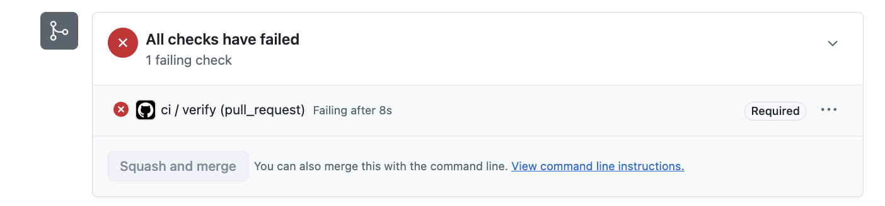
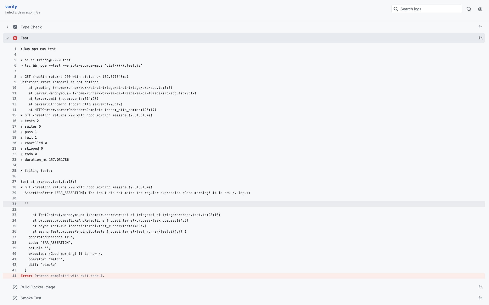

# Failure 01: Node version mismatch

## Scenario

This failure was injected on purpose. It did not happen by accident.

I wanted to use the Temporal API, which is not supported on Node 24, so I upgraded my local Node version to 26, and switched the `tsconfig.json` base to Node 26. However, `.nvmrc` and CI still stayed at Node 24.

Version mismatches between local machines and CI are common. When an error suggests upgrading Node, upgrading only your own machine feels like the fix.

To reproduce it, check out the branch [`failure/01-node-version`](https://github.com/WHL99/ai-ci-triage/tree/failure/01-node-version), run `npm ci`, then `npm test` on Node 24.

The failed CI run is on [pull request #9](https://github.com/WHL99/ai-ci-triage/pull/9), which is kept open and must not be merged.

## Symptom

The required `ci / verify` check failed after 8s, so the PR couldn't be merged.

Type Check passed.

Test failed (GET /greeting returns 200 with good morning message):
- The log shows `ReferenceError: Temporal is not defined` at `greeting (/home/runner/work/ai-ci-triage/ai-ci-triage/src/app.ts:5:5)`
- The assertion failed with an `AssertionError`, because the response body was an empty string: `The input did not match the regular expression /Good morning! It is now /. Input: ''`

Because the Test did not pass, the remaining steps did not run.
- `Build Docker Image` did not run
- `Smoke Test` did not run

## My Diagnosis (written before pushing, without seeing the CI results)

1. What will CI look like?

Type Check will pass, because it uses `tsc`, which uses the Node version in `tsconfig.json`, which has been changed to Node 26 by the developer (me).

Test will pass, because it uses Node to run `app.test.ts`. This file does not call any unsupported API from Node 24.

Build Docker Image won't pass. It calls `npm run build` to use Node 26, but the Docker image runs on Node 24.21.0, which comes from `.nvmrc`. I was not sure whether this is only a version mismatch, since the real problem is that Node 24 does not support the Temporal API.

Smoke Test won't run, because the step before it fails. If Smoke Test runs, it will pass, because it only calls `/health` endpoint, which has no conflict with Node version.

2. What could be the failure messages?

`ReferenceError: Temporal is not defined`. I did not compute `greeting()` before `writeHead(200)`.

3. Will the failure messages be printed on the CI log?

Yes, because the `catch` block logs it with `console.error`.

## Actual Result

The required check failed, so GitHub disabled the merge button:

The Test step log shows the `ReferenceError` and the `AssertionError`:

## Prediction vs Reality

|Step|Type Check|Test|Build Docker Image|Smoke Test|
|:-------:|:-------:|:-------:|:-------:|:-------:|
|My Prediction|✅|✅|❌|did not run|
|Reality|✅|❌|did not run|did not run|

### What's the difference?

**Type Check** passed, as I expected, because it did not run Node.

**Test** failed, although I predicted it would pass. The test file itself does not use Temporal, but it starts the server from `app.ts` and requests `/greeting`. This means the test runs `greeting()` in `app.ts`, which calls the Temporal API, and CI runs on Node 24, where Temporal does not exist.

**Build Docker Image** did not run. At the time, I was not sure whether this was only a version mismatch. Now I think if this step had run, it would have passed, because this step only builds an image. It doesn't run the image.

**Smoke Test** did not run. If it had run, it would not have found the issue, because it only calls `/health`, which does not use any feature that needs Node 26.

**The actual error messages:** I expected only a `ReferenceError`, but there were actually two, from different places. `greeting()` threw a `ReferenceError`, because it uses a feature that does not exist in Node 24. At that point `writeHead(200)` had already sent the status code, so the response body was an empty string. When the test received the empty body, the body check failed with an `AssertionError`.

**CI log** pointed to `src/app.ts`, because the `test` script runs Node with the flag `--enable-source-maps`.

## AI Diagnosis

I asked the local Claude Code session to commit the branch. Before committing, it ran the checks and stopped.

**What did the AI see?**

The `/greeting` test failed:

    ✖ GET /greeting returns 200 with good morning message
      The input did not match /Good morning! It is now /. Input: ''

**What was its diagnosis?**

It said `src/app.ts` uses Temporal, but the project runs on Node 24.21.0 (from `.nvmrc`), which does not have Temporal. It also explained why type-check passed: I had changed the `tsconfig.json` base to `@tsconfig/node26`, so `tsc` accepted the code, but the code still ran on Node 24.

It did not just guess. It ran `node --version` and `node -e 'console.log(typeof Temporal)'` to confirm that its shell used Node 24 and that `Temporal` was `undefined`.

**Why could it see the error locally?**

My own terminal used Node 26 (`nvm use 26`), but Claude Code ran its commands in its own shell, which still used Node 24. `nvm use` only changes the terminal where it is run. Claude's environment therefore matched `.nvmrc` and CI, so it reproduced the CI failure before I pushed.

**Was the diagnosis correct?**

Yes. It matched the CI result: `ReferenceError: Temporal is not defined` at `src/app.ts:5:5`.

**What did it do, and not do?**

It did not edit any files. It offered two fixes and asked me to choose:

- Upgrade `.nvmrc` and the Dockerfile's `NODE_VERSION` to Node 26. It noted that the Dockerfile is a protected file and needs my permission.
- Stop using Temporal and use `Date` or `Intl.DateTimeFormat` instead.

It also flagged two things I had not asked about: a change to the protected file `.claude/hooks/tsconfig.json`, and a typo in `charset:utf-8`.

**Did it edit the test?**

No. It said the test itself was correct and that the code or the Node version needed to change. In an earlier session, under the same Stop hook pressure, the agent had edited a failing assertion to make it pass. After that, I added a rule to `CLAUDE.md` against changing tests just to pass them. This time the agent followed it. One comparison does not prove the rule always works, but the behavior was different.

## Root Cause

The problem was not upgrading Node, but upgrading it in only some places.

After my changes, the versions no longer matched:

| Where | Node version |
|---|---|
| My local terminal | 26 |
| `tsconfig.json` base | 26 |
| `.nvmrc` (used by CI and the Docker image) | 24 |

`tsc` only reads `tsconfig.json`, and my terminal used Node 26, so every check passed on my machine. The only place that still used Node 24 was CI.

Nothing on my machine enforced `.nvmrc`, so I never saw a warning that my local Node did not match the project. A `pretest` script that checks whether my local Node version matches `.nvmrc` would have stopped me before I pushed.

## What would have caught it earlier

I added a `pretest` script that compares the current Node version with `.nvmrc`. npm runs it automatically before `npm test`. If the versions do not match, it prints both versions and tells me to run `nvm use`, then exits with code 1, so the tests do not run.

**How it catches this failure.** On Node 26, `npm test` would have stopped before any test ran. After switching back with `nvm use`, the `/greeting` test would have failed on my own machine with the same `ReferenceError` that CI reported. The check does not detect the Temporal problem itself. It puts me back on the project's Node version, so the existing test can catch it. The Stop hook runs `npm test`, so the same check also applies in Claude Code sessions.

**How I verified it.** On Node 24, the check printed nothing and the tests ran as usual. On Node 26, npm stopped after the check and no test ran:

    Node version mismatch. The project requires Node v24.21.0. Your current
    Node is v26.12.1. Please run nvm use 24.21.0

**Limitations**
- `pretest` only runs before `npm test`. If I only run `npm start` or `npm run build`, nothing checks the version on my machine, and the problem is not found until CI runs the tests.

- `pretest` does not check the `tsconfig.json` base. With the `node26` base, type-check still passes on Node 24. Only the runtime test catches the problem.

## Fix Options

**Option 1: upgrade the project to Node 26.**

Update `.nvmrc` to Node 26, switch the `tsconfig.json` base to `@tsconfig/node26`, upgrade `@types/node` to 26, and switch local machines with `nvm use`. The Dockerfile does not need to change: the Docker build reads its Node version from `.nvmrc`, and so do CI and the `pretest` check. One file updates all three. The risk is that some APIs may have changed or been removed in Node 26, so I would read the release notes for breaking changes and let CI run the full pipeline.

**Option 2: stop using Temporal.**

Use `Date` or `Intl.DateTimeFormat` instead, and revert the `tsconfig.json` base to `@tsconfig/node24`. The project stays on Node 24. The cost is that `Temporal` is more intuitive and easier to use than these older APIs.

If this were a real project, I would choose Option 1, because as of 28 October 2026, Node 26 is listed as LTS on the [Node.js releases page](https://nodejs.org/en/about/previous-releases).

## Lessons

**`nvm use` only affects the terminal where you run it.** On the same computer, my terminal and Claude's shell could use different Node versions. I noticed it when I asked Claude Code to commit my changes. Before Claude finished, the Stop hook ran `npm test`, which failed. I asked Claude which Node version it was using. Claude answered that it was using Node 24, which did not match my terminal. Claude and CI had the same Node version, so I noticed the error before pushing the changes. Because I wanted CI to fail on purpose, I committed and pushed from my own terminal instead.

**A `CLAUDE.md` rule changed the agent's behavior.** Earlier, I noticed Claude had changed my test file just to make a failing test pass. This was the wrong approach, because a failing test may be catching a real bug. Then I added a rule to ask the AI agent not to edit an existing test's expected value just to make it pass. This time Claude did not edit the failing test. This is only one comparison, so it does not prove the rule always works.

**The log would not have shown error messages.** If there had been no `console.error`, the log would not have shown the `ReferenceError`. The triage agent has to read logs to diagnose issues, so it cannot diagnose anything the code does not log.

## Timing

| | Time |
|---|---|
| CI run until failure | 8 seconds |
| My diagnosis, after CI turned red | under 1 minute |
| Local Claude Code's diagnosis | found before I pushed |

These numbers do not show how fast a real diagnosis is. I injected this failure myself and wrote down my prediction before pushing, so I already knew the cause when CI turned red. For the same reason, they cannot show whether the agent makes diagnosis faster: no tool is faster than already knowing the answer.

Meaningful timings need a failure whose cause I do not know in advance, for example one that happens naturally while building the project, or one that an automated triage run diagnoses on its own.