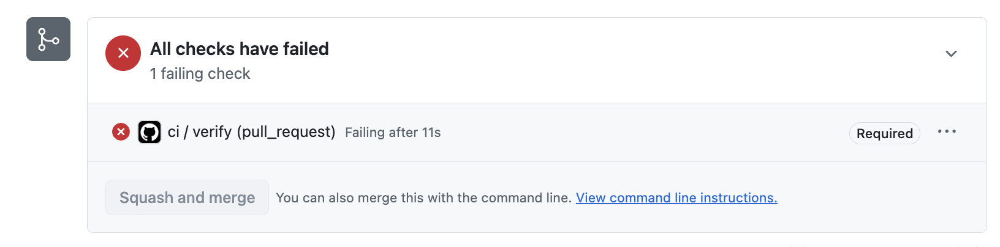
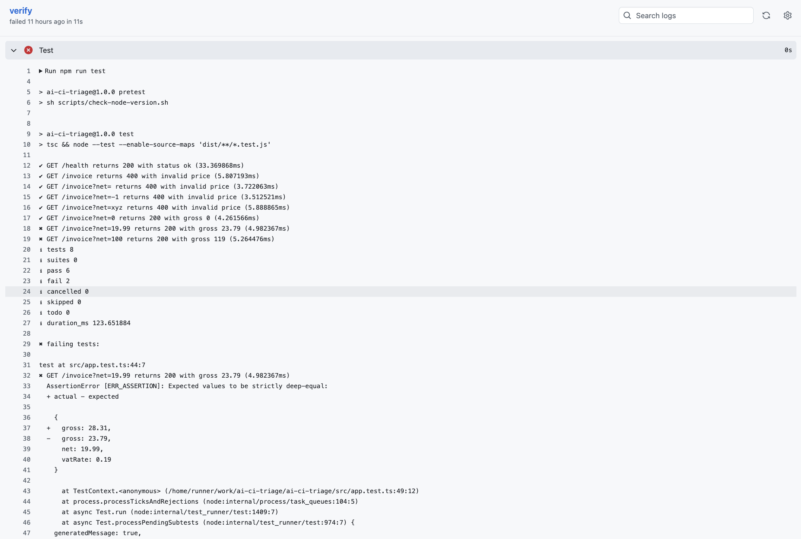
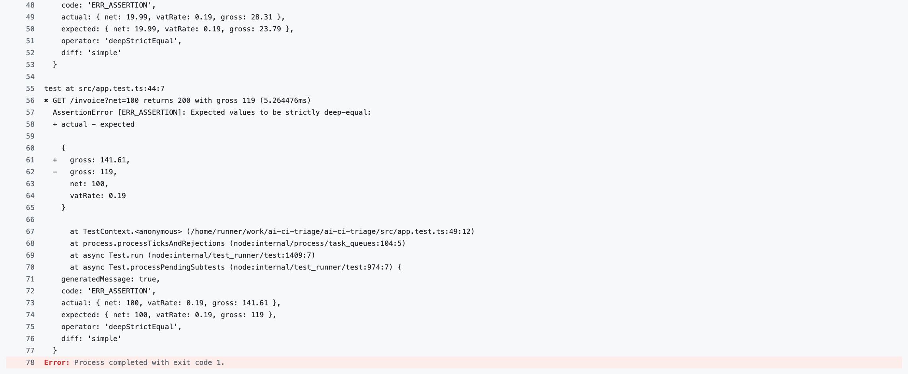

# Failure 02: VAT applied twice after a refactor

## Scenario

This failure was injected on purpose. It did not happen by accident.

I refactored the gross calculation function into `net2Gross()` in `helper.ts`. The function returned a gross price, but `app.ts` used it as a net price, so it was multiplied by the VAT rate a second time. The existing tests caught this regression.  

I have seen this kind of bug in a real project, because a name did not make clear whether a value was a net or a gross price.

To reproduce it, check out the branch [`failure/02-failing-test`](https://github.com/WHL99/ai-ci-triage/tree/failure/02-failing-test), run `npm ci`, then `npm test`.

The failed CI run is on [pull request #15](https://github.com/WHL99/ai-ci-triage/pull/15), which is kept open and must not be merged.

## Symptom

The required `ci / verify` check failed after 11s, so the PR couldn't be merged.

Type Check passed.

Test failed. Two `/invoice` tests failed with an `AssertionError` at `src/app.test.ts:49:12`: 

- `GET /invoice?net=19.99 returns 200 with gross 23.79`: gross was 28.31, but 23.79 was expected
- `GET /invoice?net=100 returns 200 with gross 119`: gross was 141.61, but 119 was expected

The other six tests passed, including `net=0`.

Nothing was logged with `console.error`. The stack traces pointed only to the test file, not to the application code.

Because the Test did not pass, the remaining steps did not run.
- `Build Docker Image` did not run
- `Smoke Test` did not run

## My Diagnosis (written before pushing, without seeing the CI results)

1. What will CI look like?

Type Check will pass.

Test will not pass.

Build Docker Image will not run, because the step before it fails. If it ran, it would pass, because this step only creates a Docker image. 

Smoke Test will not run. If it ran, it would pass, because it only calls `/health`, which has no errors. Even if it called `/invoice`, it would pass, because there is a logic error, not an application error. 

2. What could be the failure messages?

`AssertionError` in test step. 

3. Will anything be logged with `console.error`?

No, because the bug does not make the code throw an error. It is also not a server error. It is a logic error and the application works. 

## Actual Result

The required check failed, so GitHub disabled the merge button:

The Test step log shows the `AssertionError`:

## Prediction vs Reality

|Step|Type Check|Test|Build Docker Image|Smoke Test|Error Message|console.error|
|:-------:|:-------:|:-------:|:-------:|:-------:|:-------:|:-------:|
|My Prediction|✅|❌|did not run|did not run|AssertionError|no|
|Reality|✅|❌|did not run|did not run|AssertionError|no|

I predicted that if `Smoke Test` had run and called `/invoice`, it would have passed. This is because it uses `curl --fail`, which only checks the status code. `/invoice` returns 200 with a wrong gross, so `curl` treats it as a success. This means `Smoke Test` can only prove that the server is responding, but it does not guarantee that the response is correct. These steps did not run, so this is reasoning, not a verified result.

### A second bug, caught by my prediction

Before pushing, I predicted that the `net=0` test would still pass, because 0 times any rate is 0. When I ran the tests locally, it failed. The difference showed that I had also turned `gross` into a string by accident. I fixed that, so this failure has only one cause. Writing the prediction first is what caught it.

## AI Diagnosis

I asked two AI assistants to diagnose the CI failure, with different access.

| | Claude Code | Claude.ai |
|---|---|---|
| Input | The CI log, in a new session | The CI log text only |
| Access to the code and git history | Yes | No |
| Found **what** was wrong (VAT applied twice) | Yes | Yes |
| Found **where** it was wrong | Yes, `app.ts:19-20` | No |
| Diagnosis was correct | Yes | Yes |

### Claude Code, with repository access

It read `helper.ts` and `app.ts` and found that `net2Gross()` already returns a gross price, while the handler stores the result in `price` and applies VAT again. It noted that the variable name `price` hides the problem, and that the code before the refactor had a `netPrice` variable that made the distinction clear.

It also explained the passing tests: `net=0` passes because 0 stays 0 however many times VAT is applied, and the 400 tests never reach the calculation. It said the tests were correct and should not change, and suggested using the result of `net2Gross()` directly.

**Limitation: the commit message leaked the answer.** Claude Code also read my commit message, which describes the bug and the expected failures. So this run cannot show whether it would have found the cause on its own.

**What it did, and did not do.** It first offered to fix the code, not the tests. I told it to explain the cause only, so it did not edit any files because of my instruction, not because of a rule. Its own judgement was that the tests were correct.

### Claude.ai, with the CI log only

Without the code, it worked from the numbers in the log. It divided the actual gross by the net price for both failing tests and got 1.4161, which is exactly 1.19 × 1.19. From that, it concluded that VAT was applied twice, and checked that 19.99 × 1.4161 rounds to 28.31. It also explained why `net=0` and the 400 tests pass.

It could not point to the exact line. Instead, it listed common patterns that cause this bug. The first one, VAT applied inside a helper and again in the route, is exactly what happened. It suggested checking the last commit that touched the VAT logic, and adding a `net=1` test, where a double VAT would show up directly as 1.42 instead of 1.19. I have not added that test yet.

### What this shows

The CI log was enough to find **what** was wrong, but not **where**. That worked because the test uses `assert.deepEqual`, which prints the expected and actual values. A test that only checked `assert.ok(gross === 119)` would print `false`, and the log would contain no numbers to reason from.

### The Stop hook in a diagnosis-only session

Because I told Claude Code not to fix the bug, the tests were still failing when it tried to finish. The Stop hook blocked it twice, and Claude could only repeat that it would not edit anything. On the third attempt, the hook let it stop and showed:

    npm run test is still failing after 2 attempts. Claude stopped
    trying. Please run "npm run test" to see the errors.

This is the first time I saw this path in a real session, not only in a manual test. It also shows a conflict: the Stop hook makes sense when Claude is writing code, but in a session that should only diagnose, the tests are expected to fail, so the hook costs extra turns without helping. A read-only triage agent should not run with this hook.

## Root Cause

**Why was the bug easy to write?**

`net2Gross()` returns a number, and a net price is also a number. In this case TypeScript cannot tell them apart. So if I use a gross price where a net price is expected, type-check will not warn me.

It does not tell code readers whether it is a net or gross price.

**Why did my machine not catch it?** 

I committed the changes and pushed from my terminal without running the tests. Nothing on my machine runs the tests automatically before a push. The Stop hook does run them, but only in Claude Code sessions, so it did not run here. If I had used Claude Code, the Stop hook would have caught the failing tests.

This is accepted by design. Local checks can be skipped, so CI is the gate that every pull request must pass, and it caught this regression.

## What would have caught it earlier

**Keep the VAT calculation in one place.** The bug exists because two places applied VAT after the refactor. Once `net2Gross()` owns the calculation, the handler should not touch VAT at all. This is the real fix; the options below only make this kind of mistake easier to see.

**Name values by what they contain.** Calling the variable `grossPrice` instead of `price` would have made the second multiplication look wrong in review. It costs nothing.

**Unit-test the helper.** A direct test of `net2Gross()` would pass, while the `/invoice` test fails. Together, they point straight to the caller, without reasoning from the numbers in the log.

**A pre-push hook.** A Git hook, for example with Husky, could run the tests before every push. I would choose pre-push over pre-commit, so commits stay fast while work is in progress. But it can be skipped with `--no-verify`, and it does not replace CI. Here, CI caught the bug in 11 seconds, so the hook would save little.

I would do the first three, and skip the last one, because of the project size.

## Fix

Use the return value of `net2Gross()` directly in `app.ts`, and do not apply VAT again. This would fix the bug. I have not applied it on branch [`failure/02-failing-test`](https://github.com/WHL99/ai-ci-triage/tree/failure/02-failing-test), because the branch must keep failing so the failure can be reproduced.

## Lessons

**A CI log shows what failed, but not where.** With only the log, Claude.ai worked out that VAT was applied twice, but it could not find the line. Claude Code found the line because it could read the code. The log was useful at all only because `assert.deepEqual` prints the expected and actual values. How a test asserts decides how much a triage agent can learn from its failure.

**To evaluate an AI diagnosis, hide the answer.** Claude Code read my commit message, which described the bug, so its correct diagnosis proves little. The log-only run was the real test. For future injected failures, the commit message should stay neutral until the diagnosis is recorded.

**A guardrail that helps one task can block another.** The Stop hook keeps Claude from finishing while tests fail, which is right when it writes code. In a session that should only diagnose, the tests are expected to fail, so the hook blocked Claude twice without helping. The read-only triage agent should not run with this hook.

## Timing

| | Time |
|---|---|
| CI run until failure | 11 seconds |
| My diagnosis, after CI turned red | known in advance |
| Claude Code's diagnosis | around 1 minute  |
| Claude.ai's diagnosis | 20 seconds |

These numbers do not show how fast a real diagnosis is. I injected the bug myself, so I knew the cause before CI ran. Claude Code also read my commit message, which described the bug. Only the Claude.ai run had no access to the answer.