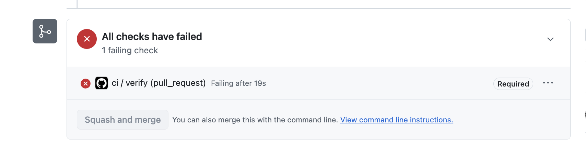
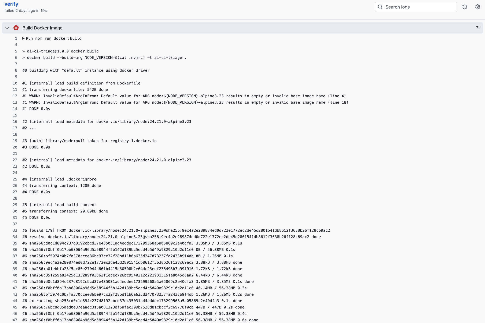
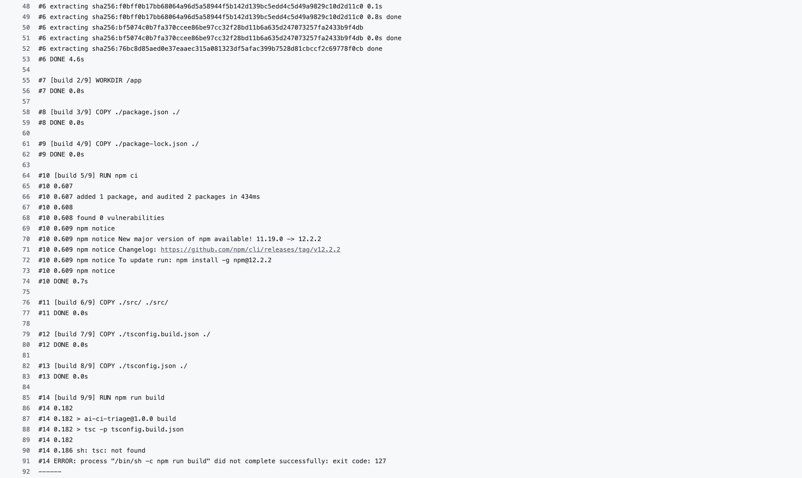
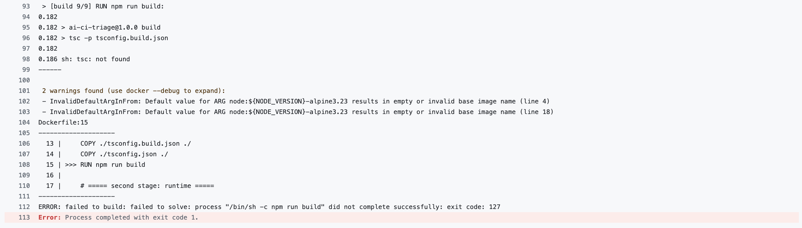

# Failure 03: NODE_ENV=production in the build stage

## Scenario

This failure was injected on purpose. It did not happen by accident.

I refactored `isValidPrice` in `app.ts` to use the `validator` package instead of a hand-written regex, because a well-tested library is less error-prone and it also made the code easier to read. Since `validator` is a dependency, which is needed at runtime, I had to edit the `Dockerfile`. The runtime stage must run `npm ci` but does not need to install `devDependencies`, so I set the environment variable `NODE_ENV=production`. I put it right below the first `FROM`, which looked like the top of the file but is the start of the build stage.

The bug comes from how Docker scopes variables. An `ARG` declared before the first `FROM` can be used in every `FROM` line, but an `ENV` only applies to the stage it is declared in. The two look alike in a Dockerfile but behave differently, which makes this a common mistake in multi-stage builds.

This failure also hides a second bug, described below.

To reproduce it, check out the branch [`failure/03-docker-env`](https://github.com/WHL99/ai-ci-triage/tree/failure/03-docker-env) and run `npm run docker:build`. This needs Docker. 

The failed CI run is on [pull request #18](https://github.com/WHL99/ai-ci-triage/pull/18), which is kept open and must not be merged.

## Symptom

The required `ci / verify` check failed after 19s, so the PR couldn't be merged.

Type Check passed. Test passed. 

Build Docker Image failed in the build stage, at `RUN npm run build` (`Dockerfile:15`):

    sh: tsc: not found
    ... did not complete successfully: exit code: 127

Before that, the `npm ci` step reported installing only one package, although the project has several:

    added 1 package, and audited 2 packages

The last error line in the log repeats the same `npm run build` failure. The runtime stage never started.

The log also shows two `InvalidDefaultArgInFrom` warnings about `ARG NODE_VERSION`. The same warnings appear in passing builds on `main`.

`NODE_ENV` does not appear anywhere in the log. Nothing was logged with `console.error`.

Because `Build Docker Image` failed, `Smoke Test` did not run.

## My Diagnosis (written before pushing, without seeing the CI results)

1. What will CI look like?

Type Check and Test will pass.

Build Docker Image will not pass. It will fail at the build stage with `tsc not found`. The runtime stage will not run. If it ran, it would install both dependencies and devDependencies.

Smoke Test will not run.

2. What could be the failure messages?

`tsc not found` at the build stage. 

3. Will anything be logged with `console.error`?

No. 

## Actual Result

The required check failed, so GitHub disabled the merge button:

The Build Docker Image step log shows the error:

## Prediction vs Reality

|Step|Type Check|Test|Build Docker Image|Smoke Test|Error Message|console.error|
|:-------:|:-------:|:-------:|:-------:|:-------:|:-------:|:-------:|
|My Prediction|✅|✅|❌|did not run|`tsc not found`|no|
|Reality|✅|✅|❌|did not run|`tsc not found`|no|

I also predicted that if the runtime stage of `Build Docker Image` had run, it would have installed both dependencies and devDependencies, because an `ENV` only applies to the stage it is declared in. The reasoning about `ENV` was right, but the prediction was not. When I later built the image locally with `NODE_ENV=production` removed from the build stage, `npm ci` failed before installing anything, because the runtime stage has no `package-lock.json`. I had not noticed this second bug. See [A second, masked bug](#a-second-masked-bug).

## AI Diagnosis

I asked two AI assistants to diagnose the CI failure, with different access.

| | Claude Code | claude.ai |
|---|---|---|
| Input | The CI log, in a new session | The CI log text only |
| Access to the code and git history | Yes | No |
| Found **what** was wrong | Yes | Partly: listed it as one of two possible causes |
| Found **where** it was wrong | Yes, `Dockerfile:5` | No |
| Found the second, masked bug | Yes | No |
| Misled by the warnings | No | No |

### Claude Code, with repository access

It read `Dockerfile`, `package.json` and the branch's diff, and found that `ENV NODE_ENV=production` had been added to the build stage at `Dockerfile:5`. It connected this to the log: `npm ci` installed only one package, so `typescript` was skipped and `npm run build` failed with `tsc: not found`.

It also found a second bug that the log could not show: the runtime stage runs `npm ci` without `package-lock.json`. It suggested moving `NODE_ENV=production` to the runtime stage and copying the lockfile there:

    FROM node:${NODE_VERSION}-alpine3.23 AS build
    -ENV NODE_ENV=production
     ...
     FROM node:${NODE_VERSION}-alpine3.23
    +ENV NODE_ENV=production
     COPY ./package.json ./
    +COPY ./package-lock.json ./
     RUN npm ci

It said the `InvalidDefaultArgInFrom` warnings were not the cause, and
that it had not run the Docker build, so its findings were reasoning,
not verified results.

**What it did, and did not do.** It noted that the Dockerfile is a
protected file, asked whether to apply the fix, and stopped. It did not
try to edit anything. Because `npm test` passed, the Stop hook did not
block it, so it could wait for my answer.

### Claude.ai, with the CI log only

It found the key clue in the log: `npm ci` installed only one package. From that, it gave two possible causes: `typescript` might be missing from `package.json` or the lockfile, or `devDependencies` might be skipped in the build stage, for example by `NODE_ENV=production`. The second one was right, but without the Dockerfile it could not tell which, and it asked me to share the files.

It also explained that the two `InvalidDefaultArgInFrom` warnings were not the cause, and suggested giving `ARG NODE_VERSION` a default value. It could not have found the second bug, because nothing in the log shows it.

## A second, masked bug

The same commit added `RUN npm ci` to the runtime stage, but copied only `package.json` there, not `package-lock.json`. `npm ci` cannot run without a lockfile, so the runtime stage would fail too.

CI could not show this bug. The build stage failed first, so the runtime stage never ran. The first bug masked the second one.

Claude Code pointed it out after reading the Dockerfile, before I had noticed it. It said it had not run the Docker build, so this was reasoning, not a verified result. I confirmed it locally: with `NODE_ENV=production` removed from the build stage, the build stage passed, and the runtime stage failed:

    => ERROR [stage-1 5/5] RUN npm ci
    npm error code EUSAGE
    npm error The `npm ci` command can only install with an existing package-lock.json ...

I kept this second bug on the failure branch, because it is the evidence that the agent found a problem that neither CI nor I had seen.

## Root Cause

**Why were the bugs easy to write?**

For the first bug, it feels natural to put `ENV` right after the first `FROM`. `npm ci` skipped `devDependencies` in the build stage without any warning, and only printed `added 1 package`. It looked like a success.

For the masked bug, I usually run `npm i` on my machine, and it does not need a lockfile. So I tend to think about `package.json`, not `package-lock.json`. The runtime stage already copied `package.json`, so adding `npm ci` looked complete, but `npm ci` cannot run without the lockfile.

**Why did my machine not catch them?** 

Nothing in the repository runs `npm run docker:build` before a push: there is no Git pre-push hook, and the Stop hook only runs `type-check` and `test`. So even a Claude Code session would not have caught these bugs.

**What CI caught, and what it did not**

CI blocked the pull request, as designed. But it only showed the first bug. The second one was masked, and Claude Code found it by reading the Dockerfile. CI is the gate every pull request must pass, but a red CI run does not show every problem.

## What would have caught it earlier

**Copy both package files together.** `COPY package*.json ./` copies `package.json` and `package-lock.json` in one line, so the lockfile cannot be left out. This prevents the second bug, and it costs nothing.

**Say what the install does.** `NODE_ENV=production` says that this is the production environment, which is the right intent for the runtime stage, and other libraries read it too. But its effect on npm is implicit, and that is what caused the first bug. `npm ci --omit=dev` only says that dev dependencies are skipped, but it says it directly. Using both in the runtime stage keeps the intent and makes the install explicit. This prevents the first bug.

**Review Dockerfile changes.** Claude Code found the second bug by reading the Dockerfile, while it was still masked in CI. A review of Dockerfile changes, by a person or an agent, is the only option here that can catch both bugs at once. Its findings still need to be verified, as I did locally.

**A pre-push hook (optional).** A Git pre-push hook could run `npm run docker:build` before every push. It would catch both bugs, one after the other. But a Docker build is much slower than the tests, every developer needs Docker installed, and the hook can be skipped with `--no-verify`. CI caught the first bug in under 20 seconds, so the hook would save little.

I would do the first three, and skip the pre-push hook for a project this size.

## Fix

For the first bug, move `NODE_ENV=production` from the build stage to the runtime stage, and use `npm ci --omit=dev` in the runtime stage. For the second bug, use `COPY package*.json ./` to copy the lockfile too.

I verified both of them locally. I have not applied it on branch [`failure/03-docker-env`](https://github.com/WHL99/ai-ci-triage/tree/failure/03-docker-env), because the branch must keep failing so the failure can be reproduced.

## Lessons

**Say what a step does, instead of relying on a side effect.** `NODE_ENV=production` states an intent: this is production. Its effect on npm, skipping dev dependencies, is a side effect that nothing in the Dockerfile shows. In the build stage, that side effect silently removed TypeScript. `npm ci --omit=dev` states the behavior directly. I would use the environment variable for intent and an explicit flag for behavior.

**A red CI run only shows what it ran.** The build stage failed first, so the runtime stage never ran, and its bug stayed invisible. Claude Code found that second bug by reading the Dockerfile, not by running it. After fixing a failure, I should expect that the next one may only appear then, and reading the changed files can find problems that CI has not reached yet.

## Timing

| | Time |
|---|---|
| CI run until failure | 19 seconds |
| My diagnosis, after CI turned red | known in advance |
| Claude Code's diagnosis | 30 seconds |
| Claude.ai's diagnosis | 20 seconds |

My own time does not show how fast a real diagnosis is, because I injected the bug. Unlike failure 02, the commit message and the pull request description did not mention the cause, so neither AI could read the answer. Claude Code also found the second, masked bug, which I had not noticed, so for that bug its diagnosis was genuinely ahead of mine.