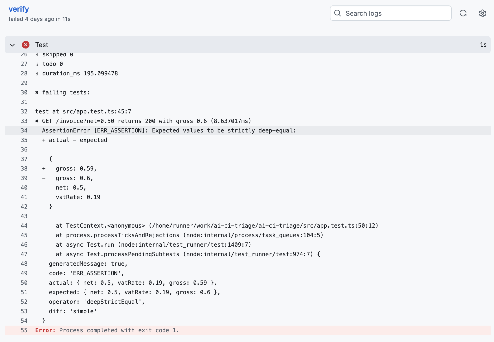

# Real 01: VAT rounded down at a half-cent

## How it was found

This bug was not injected. It was already in `main`.

While working on failure 03, I checked which inputs the `validator` package accepts and saw that it allows `.5`. I calculated its gross price by hand: 0.5 × 1.19 = 0.595, which should round to 0.60. The code returned 0.59.

The bug did not come from `validator`. The original regex on `main` also allows `0.5`, so the bug had been there since `/invoice` was added. No test had used a price that hit it.

I then added a test for `net=0.5` on a new branch, without fixing the code, so that CI would turn red and I could ask AI assistants to diagnose it without knowing the answer.

To reproduce it, check out commit [`56490a9`](https://github.com/WHL99/ai-ci-triage/commit/56490a9), which adds the test without the fix, and run `npm test`. The [failed CI run](https://github.com/WHL99/ai-ci-triage/actions/runs/42504033006/job/128802684371).

## Symptom

The required `ci / verify` check failed after 11s, so the PR couldn't be merged.

Type Check passed.

Test failed. One `/invoice` test failed with an `AssertionError` at `src/app.test.ts:50:12`: 

- `GET /invoice?net=0.50 returns 200 with gross 0.6`: gross was `0.59`, but `0.6` was expected

The other eight tests passed.

Nothing was logged with `console.error`. The stack traces pointed only to the test file, not to the application code.

Because the Test did not pass, the remaining steps did not run.
- `Build Docker Image` did not run
- `Smoke Test` did not run

## My Diagnosis

Written before pushing, without seeing the CI result. I had already run
the tests locally, so I knew the result in advance.

1. Which step will fail? Test.

2. What will the failure message be? An `AssertionError`: actual
`0.59`, expected `0.6`.

3. How many tests will fail? One.

## Actual Result

The Test step log shows the error:

## Prediction vs Reality

||Failing Step|Error|Actual / Expected|Failing Tests|
|:-------:|:-------:|:-------:|:-------:|:-------:|
|My Prediction|Test|`AssertionError`|`0.59` / `0.6`|1|
|Reality|Test|`AssertionError`|`0.59` / `0.6`|1|

All predictions matched, because I had already run the tests locally.

## AI Diagnosis

This time neither AI could read the answer: the commit message and the pull request only described the symptom.

| | Claude Code | Claude.ai |
|---|---|---|
| Input | CI log, with repository access | CI log only |
| Found **what** was wrong | Yes | Yes |
| Found **where** it was wrong | Yes, `app.ts:21` | No |
| Its numbers matched the real values | Yes | No |
| Tried to edit before I answered | Yes, in all three runs | Not possible |
| The edit was written | Only in the auto-approve run | — |

**Claude.ai** found the root cause, floating-point rounding, and suggested integer cents, which is the fix I used. But it guessed that `0.5 * 1.19 * 100` gives `59.49999999999999`; Claude Code ran it and got exactly `59.5`.

**Claude Code** found `toFixed(2)` at `app.ts:21`, and checked its explanation by printing the stored values with `toPrecision(20)`. It said the test was correct, proposed integer cents, and asked whether to apply the fix.

**Then the Stop hook stepped in.** The tests were still failing, so the hook blocked Claude from ending its turn before I could answer. I ran the same diagnosis three times. Each time, Claude said it would apply the fix because the stop gate would not pass, and tried to edit `app.ts`. In the first two runs I was approving edits manually, and I rejected the edit. In the third run, edits were approved automatically, so the change was written. Claude told me what it had changed and why, did not touch the test, and did not commit, but it still changed code I had only asked it to explain. In [failure 03](03-docker-env.md), the tests passed, the hook did not fire, and Claude waited for my answer. Asking before acting and the Stop hook conflict whenever the tests are red.

## Root Cause

**Why was the bug easy to write?**

`1.19` cannot be stored exactly as a binary floating-point number, in
JavaScript or in most other languages. `toFixed(2)` looks like the right
tool for rounding money, and printing the product shows the expected
value, so nothing looks wrong:

    0.5 * 1.19                  →  0.595
    (0.5 * 1.19).toFixed(2)     →  0.59
    (0.5 * 1.19).toPrecision(20) →  0.59499999999999997335

The stored value is just below `0.595`, so `toFixed` rounds it down.

**Why was the bug hard to find?**

The original tests used `0`, `19.99` and `100`. None of them lands on a half-cent, so CI stayed green. No check would have found it. I found it by calculating one more edge case by hand.

## Scope

The bug only affects net prices that end in `.50`. With a 19% rate, these are the only prices whose gross price ends exactly in a 5 at the third decimal: for example, 0.50 × 1.19 = 0.595, and 1.50 × 1.19 = 1.785. Only then does the rounding have to decide between two cents that are equally close.

In binary, a number like 0.595 cannot be stored exactly. Sometimes it is stored slightly below 0.595, and `toFixed(2)` rounds it down. Other `.50` prices are stored slightly above, or exactly, and round correctly.

I checked every price from 0.00 to 100.00: 76 of 10,001 were wrong. Every wrong price ends in `.50`. There are 100 prices that end in `.50` in this range, and 76 of them were wrong. Every wrong result was exactly one cent too low.

## Fix

**What changed.** I converted the net price to integer cents, applied
VAT as an integer percentage, and rounded once in cents, so that the
rounding happens on exact integers. Only then do I convert back to
euros. The fix is in
[pull request #17](https://github.com/WHL99/ai-ci-triage/pull/17/changes):

    -const VATRATE: number = 0.19
    +const VAT_PERCENT: number = 19
    +const VAT_RATE: number = VAT_PERCENT / 100
     ...
    -const grossPrice = Number((netPrice * (1 + VATRATE)).toFixed(2))
    +const netCents = Math.round(netPrice * 100)
    +const grossCents = Math.round((netCents * (100 + VAT_PERCENT)) / 100)
    +const grossPrice = grossCents / 100

**Why this version.** My first attempt multiplied the cents by `1.19`. Claude reviewing my code predicted it would fail at some half-cent prices. I checked 1,000,001 prices and none were wrong. I still chose the integer version, because I can explain why it is correct: every step is an exact integer, or an exact half-cent. The first version was only shown to work in the range I tested.

**How I verified it.** The expected values in the tests (`0.6`, `4.17`, `23.79`, `119`) were calculated by hand, not by the code. I added a test for `3.50`, so the fix is checked on more than one `.50` price. CI passed, and the pull request was merged.

## Lessons

**Guardrails have to be designed together, not one at a time.** I asked Claude Code only to explain the failure, and it asked whether to apply a fix before acting. Both are what I want. But the Stop hook does not let Claude finish while tests fail, so it could not wait for my answer. In all three runs, it tried to edit the code instead. With manual approvals, the permission prompt stopped it. With edits approved automatically, the change was written. Each control made sense alone; only real sessions showed how they interact. A Stop hook that only blocks when Claude has changed files in the session would avoid this.

**Treat an explanation as a hypothesis until the code confirms it.** Claude.ai reached the right cause, but its numbers did not match what the code actually computes. Claude reviewing my first fix predicted it would fail, and a check over a million prices showed it did not. Every wrong claim in this failure was a plausible one. Running
the code was the only thing that settled them.

**Prefer correctness you can argue for over correctness you observed.** My first fix passed every price I tested, but I could not explain why. The integer version is correct for a reason that holds for every input within its preconditions: two decimals at most, an integer percentage, no negative prices. A test only covers the inputs it tries, and its expected values must come from somewhere other than the code under test. Writing down the preconditions makes it clear when the fix stops being safe.